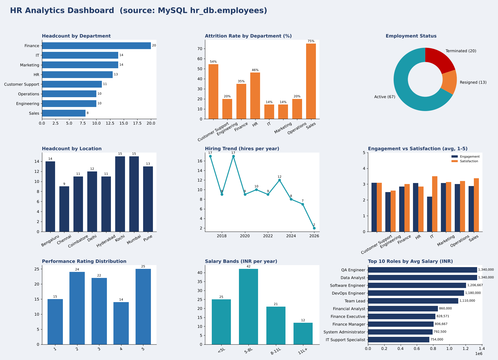

# HR Workforce Analytics: an end-to-end dashboard project

Excel, MySQL, Power BI and Tableau on a 100-employee HR dataset

| Employees | Active | Left | Attrition rate |
|---|---|---|---|
| 100 | 67 | 33 | 33% |

## Overview
I took a raw HR dataset of 100 employee records and built the same analysis in four tools: Excel, MySQL, Power BI and Tableau. The goal was to answer one business question: where is the company losing people, and what does the data say about why? This page summarises the dataset, my method, what I found and what I would recommend.

## The dataset
| Fields | What they hold |
|---|---|
| Employee_ID, Department, Job_Role, Location | Who the employee is and where they work (8 departments, 8 locations, 29 job roles) |
| Hire_Date, Exit_Date, Employment_Status | Tenure and outcome: Active, Resigned or Terminated |
| Annual_Salary | Yearly pay in rupees (INR) |
| Performance_Rating, Engagement_Score, Satisfaction_Score | Scores on a 1 to 5 scale |
| Training_Hours | Hours of training per employee |

## How I built it
1. **Clean and explore (Excel).** Converted dates, built an Excel Table, added helper columns (tenure, hire year, attrition flag, salary band) and built a KPI dashboard with formulas and charts.
2. **Store and query (MySQL).** Designed the employees table, loaded all 100 rows and wrote 8 SQL views, one per dashboard chart, using GROUP BY, CASE and date functions.
3. **Model and visualise (Power BI).** Wrote DAX measures such as Attrition % and Average Tenure, then built an interactive report with slicers.
4. **Tell the story (Tableau).** Created calculated fields and a colour-coded dashboard with KPI tiles and a mix of chart types.

## Dashboard preview

## Key findings
1. **A third of the workforce has left.** 33 of 100 employees are no longer active: 20 were terminated and 13 resigned.
2. **Attrition is concentrated in three departments.** Sales loses 75% (6 of 8), Customer Support 55% (6 of 11) and HR 46% (6 of 13). IT and Marketing are lowest at 14% (2 of 14 each).
3. **Pune and Coimbatore stand out.** Attrition is 46% in Pune and 45% in Coimbatore, against 21% in Bengaluru and 22% in Chennai.
4. **Exits are speeding up.** 13 employees left in 2025, compared with 4 in 2024. The data already shows 6 exits in 2026.
5. **Hiring has slowed.** 17 people were hired in each of 2017 and 2019, against 7 in 2025 and 2 in 2026 (a part year).
6. **Pay differs by team but does not explain exits on its own.** Engineering averages 12.2 lakh a year and Customer Support 4.5 lakh. People who left earned 6.9 lakh on average against 7.4 lakh for active staff, and the correlation between salary and leaving is weak (-0.08).
7. **Engagement is low overall and slightly lower for leavers.** The average engagement score is 2.83 out of 5: 2.64 for leavers and 2.93 for active staff. IT has the lowest engagement (2.21) yet the lowest attrition.
8. **Good performers leave at the same rate as everyone else.** 13 of the 39 employees rated 4 or 5 have left (33%). The average tenure at exit is 3.2 years.

## Recommendations
- Run retention reviews in Sales, Customer Support and HR first, since they hold 18 of the 33 exits.
- Check pay bands for support roles: Support Team Leads average 4.2 lakh and Support Executives 4.3 lakh.
- Look into Pune and Coimbatore (manager, workload, role mix) to see what sets them apart.
- Start recording exit reasons and manager IDs. The data shows where people leave, not why.
- Create a retention plan for high performers, who currently leave as often as anyone.

## Limitations
This is a sample dataset of 100 records. Department groups hold only 8 to 20 people, so a single exit moves a percentage a lot. The dataset has no exit reasons, so the findings describe patterns, not causes.

## Skills shown
- Excel: tables, formulas, pivot tables, charts
- SQL: MySQL schema design, imports, views, aggregation
- Power BI: DAX measures, slicers, report design
- Tableau: calculated fields, dashboards, colour and layout
- Data cleaning, KPI design and data storytelling

## Files in this repository
- `hr_database.sql`: MySQL schema, data and 8 views
- `HR_Dashboard.xlsx`: Excel dashboard
- `HR_Dashboard.pbix`: Power BI report
- `HR_Dashboard.twbx`: Tableau workbook
- `HR_Portfolio_Case_Study.pdf`: this case study as a PDF
